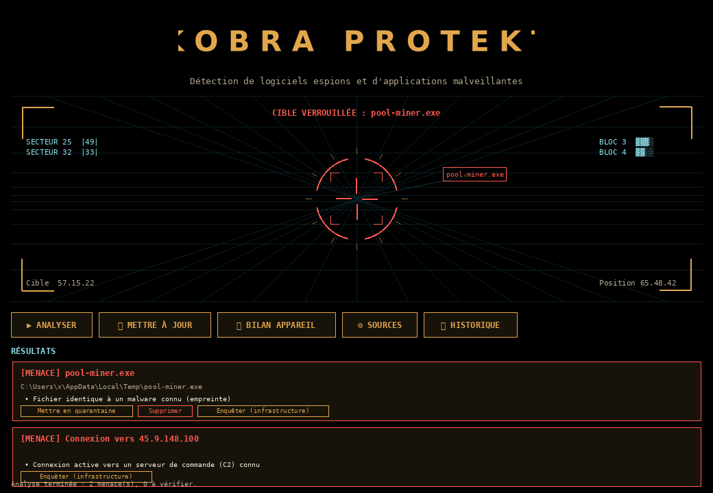

# Kobra Protekt — Windows

Portage Windows de votre application KobraProtekt (Android), avec le nouveau
logo **Kobra Protekt** (lettrage espacé) et une interface de type **HUD de
visée**. L'application recherche les logiciels espions et programmes
malveillants, les fait « passer dans la cible » à la détection, puis propose
leur mise en quarantaine ou leur suppression.



## Construire l'exécutable (.exe)

> L'exécutable Windows se construit **sur Windows** (un `.exe` ne peut pas être
> produit depuis Linux/Mac). Tout est automatisé par `build.bat`.

1. Installer **Python 3.10+** depuis <https://www.python.org> en cochant
   *« Add python.exe to PATH »*.
2. Double-cliquer sur **`build.bat`**. Il installe PyInstaller + Pillow et
   produit **`dist\KobraProtekt.exe`** (fichier unique, icône cobra intégrée).
3. Lancer `dist\KobraProtekt.exe`, ou double-cliquer sur **`run.bat`**
   (qui lance l'exe s'il existe, sinon l'app directement en Python).

Pour tester sans construire l'exe : `run.bat` suffit (il lance
`python -m kobra_protekt`). `tkinter` est inclus par défaut avec le programme
d'installation officiel de Python sous Windows.

## Le menu (interface HUD)

| Bouton | Action |
|---|---|
| **▶ Analyser** | Analyse fichiers surveillés, processus et connexions réseau |
| **⟳ Mettre à jour** | Télécharge les dernières listes publiques de menaces |
| **⌖ Bilan appareil** | Analyse complète de la machine |
| **⚙ Sources** | Clés de services (facultatives) et listes supplémentaires |
| **▣ Historique** | Journal local des détections et actions |

### « Passer dans la cible » avant suppression

Dès qu'une menace est détectée, elle **vole vers le réticule central** du HUD,
le réticule **se verrouille en rouge** (« CIBLE VERROUILLÉE »), puis l'élément
apparaît dans les résultats avec ses actions. La suppression ou la mise en
quarantaine **demande toujours une confirmation** (aucune suppression
silencieuse).

## Ce que l'analyse regarde (équivalent Windows du scan Android)

- **Fichiers** des dossiers surveillés (Téléchargements, Bureau, Temp,
  Démarrage) : empreinte SHA-256 comparée à la base ; exécutable non signé
  lancé depuis un dossier temporaire.
- **Processus** en cours : chemin, empreinte, emplacement suspect.
- **Connexions réseau** actives (`netstat`) : IP distantes comparées aux
  serveurs de commande (C2) connus.

## Enquête et signalement (infrastructure, jamais une personne)

Le bouton **« Enquêter »** d'une menace réseau :

- identifie l'**infrastructure** (serveurs, hébergeur) via les registres
  publics **DNS** et **RDAP** — l'app **ne contacte jamais** le serveur
  suspect ;
- avec une clé **AbuseIPDB**, ajoute la réputation de l'adresse ;
- compile **automatiquement** un **dossier de preuves** (empreinte, emplacement,
  IP, hébergeur, pays, contact d'abus, réputation, méthode et limites).

Le **signalement** suit vos garde-fous d'origine (`report_policy.py`, port
fidèle de `ReportPolicy.java`) : proposé **uniquement** pour une menace
**confirmée**, et **jamais** quand l'adresse est privée, sur un **CDN**
(Cloudflare, Akamai…) ou une **plateforme partagée** (Firebase, AWS…).

Conformément au choix retenu, le dossier est préparé automatiquement mais
**rien n'est envoyé sans votre validation** (un clic). À la validation :

1. **Hébergeur** — un courriel pré-rédigé s'ouvre dans votre messagerie
   (à relire avant envoi) ;
2. **AbuseIPDB** — publication du signalement (si une clé est saisie) ;
3. **France** — ouverture de **cybermalveillance.gouv.fr** pour le dépôt
   officiel.

> Pourquoi une validation plutôt qu'un envoi 100 % automatique : une IP ne
> prouve pas l'identité d'une personne (usurpation, partage NAT, machine tierce
> compromise — l'app détecte elle-même les proxys résidentiels qui exploitent
> des victimes). Un envoi automatique non relu risquerait d'accuser un
> innocent. La relecture préserve les garde-fous de votre application.

## Clés de services (gratuites, facultatives)

| Service | Où | Usage |
|---|---|---|
| MalwareBazaar (abuse.ch) | auth.abuse.ch | empreintes récentes |
| AbuseIPDB | abuseipdb.com | réputation IP + signalement |

Sans clé, rien n'est envoyé à ces services : les listes Feodo Tracker et
URLhaus sont téléchargées puis comparées **sur la machine**.

## Confidentialité

- Les listes de signatures sont téléchargées puis comparées localement.
- Base, historique et quarantaine restent dans `%APPDATA%\KobraProtekt`.
- L'enquête envoie les noms/adresses relevés aux registres publics (DNS, RDAP)
  et, avec une clé, à AbuseIPDB. Jamais au serveur suspect.

## Limites à connaître

- Ce n'est pas un antivirus complet : gardez Microsoft Defender actif.
- La détection repose sur des signatures publiques et le comportement ; un
  malware chiffré ou inconnu peut échapper à l'analyse.
- Une correspondance par nom seul peut être un faux positif : vérifiez avant de
  supprimer.
- L'app ne tente jamais rien **contre** un serveur suspect ; elle ne fait que
  l'identifier et préparer un signalement que vous relisez.

## Organisation du code

```
kobra_protekt/
  app.py            Interface HUD, menu, flux détection → cible → suppression
  hud.py            Canvas HUD : grille, réticule, télémétrie, « acquire »
  theme.py          Palette or sur noir (reprise du logo)
  signatures.py     Base de signatures + mise à jour des listes publiques
  scanner.py        Analyse fichiers / processus / connexions
  investigate.py    DNS / RDAP / AbuseIPDB (infrastructure uniquement)
  report_policy.py  Garde-fous de signalement (port de ReportPolicy.java)
  report.py         Dossier de preuves + envois (après validation)
  store.py          Historique + préférences (local)
assets/             logo.png, wordmark.png, emblem.png, kobra.ico
build.bat           Construit dist\KobraProtekt.exe
run.bat             Lance l'app (exe ou Python)
```
